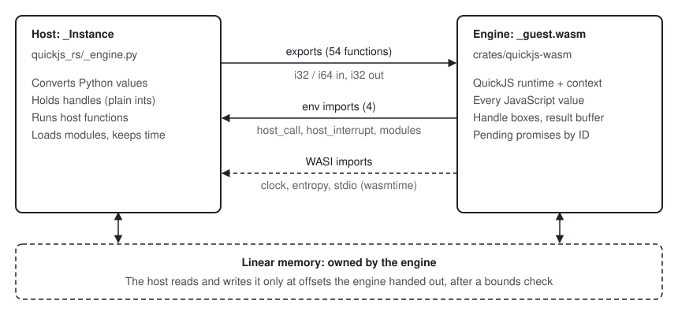
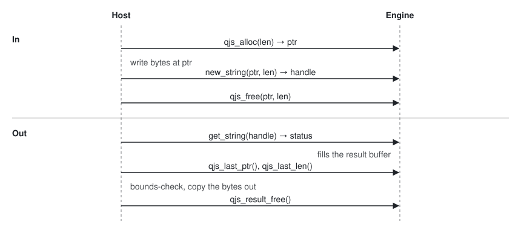
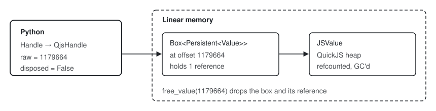

# Engine ABI

This page is the contract between `quickjs_rs/_engine.py` (the host) and `_guest.wasm` (the engine). Read it to audit
the boundary, or to drive the engine from another host. Nothing here is public API. It changes between releases
without notice.

The two sides share three things and nothing else: the exports the engine offers, the imports the host provides, and
the engine's linear memory, which the host can read and write.

## Conventions

Every export takes and returns wasm integers. A pointer is an `i32` offset into linear memory. A length is an `i32`
byte count. There are four return shapes:

| Shape | Returns | On failure | Examples |
| --- | --- | --- | --- |
| Status + out slot | A status code. The result goes to a pointer the host passes in. | Non-zero status. A handle slot is set to `0`. | `get_prop`, `eval_code`, `call_function` |
| Status + result buffer | A status code. The result bytes go to the result buffer. | Non-zero status. | `get_string`, `to_json`, `type_of` |
| Handle | A new handle. | `0` | `new_string`, `new_object`, `global_object`, `dup_handle` |
| Nothing | | | `free_value`, `qjs_free`, `run_gc`, `set_memory_limit` |

Status codes:

| Code | Name | Meaning |
| --- | --- | --- |
| `0` | `STATUS_OK` | Success |
| `1` | `STATUS_JS_ERROR` | A JavaScript exception is pending. The host takes it with `last_exception`. |
| `2` | `STATUS_BAD_INPUT` | A null pointer, bad UTF-8, the wrong value type, an input over its cap, or an unknown deferred ID |
| `3` | `STATUS_PANIC` | A Rust panic, caught at the export |
| `4` | `STATUS_NO_ENGINE` | The QuickJS runtime or context could not be created |

## Moving bytes

Bytes cross through engine memory in both directions. The engine owns every buffer, including the ones the host fills.

- **In.** The host calls `qjs_alloc(len)`, writes the bytes, passes `(ptr, len)` to the export, and calls
  `qjs_free(ptr, len)` with the same length afterwards. The export copies what it needs, so the buffer can go as soon
  as the call returns.
- **Out.** There is one result buffer. Each export that produces bytes replaces its contents, so the host copies them
  out before its next call.
- **Out slots.** A status export that returns a handle or number takes a pointer to write it to. The host allocates the
  slot with `qjs_alloc(4)`, or `qjs_alloc(8)` for a number, and frees it after reading.
- **Numbers** cross as raw IEEE 754 bits: `new_number` takes an `i64`, and `get_number` writes 8 bytes.

## Handles

A JavaScript value never leaves the engine. The host refers to it by a handle: the address of a boxed rquickjs
`Persistent<Value>` in engine memory. Each handle holds one reference to its value, so the value lives at least as long
as the handle.

Who frees a handle depends on how it was made:

| Handle | Owner | Freed by |
| --- | --- | --- |
| Returned by an export (`new_*`, `get_prop`, `eval_code`, `dup_handle`) | The host | The host, with `free_value` |
| `this` and arguments passed to `host_call` | The engine | The engine, when `host_call` returns. The host reads them and keeps nothing. |
| Returned from `host_call` | Passes to the engine | The engine |
| Passed to `resolve_deferred` or `reject_deferred` | Passes to the engine | The engine |
| Passed to `set_prop`, `set_index`, `call_function`, `throw` | Stays with the host | The host. The engine takes its own reference. |

`dup_handle` makes a second, independent handle to the same value. Both must be freed. `0` is never a valid handle.

The engine cannot tell a live handle from a freed or made-up one. A stale handle is a use-after-free inside the engine.
The host guards against that with the `disposed` flag on `QjsHandle`, and it never takes a handle value from a script.

## Imports

The engine imports four functions under `env`. quickjs-rs defines them once on shared linkers and routes each call to
the right instance (see [routing across threads](../reference/architecture.md#routing-across-threads)).

| Import | Signature | Returns |
| --- | --- | --- |
| `host_call` | `(name_ptr, name_len, this, argc, argv_ptr) -> i32` | A result handle the engine now owns, or `-1` for failure |
| `host_interrupt` | `() -> i32` | Non-zero to stop the running script. Called only by runtimes with a host `clock`; others check the deadline in `deadline_slot_ptr()`'s slot. |
| `host_module_normalize` | `(base_ptr, base_len, spec_ptr, spec_len, out_len_ptr) -> i32` | A pointer to the canonical name, with its length written to `out_len_ptr`. `0` refuses. |
| `host_module_load` | `(name_ptr, name_len, out_len_ptr) -> i32` | A pointer to the module source, with its length written to `out_len_ptr`. `0` means not found. |

The module imports return memory the host allocated with `qjs_alloc`. The engine copies it and frees it, and it rejects
a name over 4096 bytes or source over 16 MiB.

A host call is the one place where control goes back and forth inside a single export call:

On `-1`, the engine throws `HostError: Host function failed` unless the host already set an exception with `throw`.
An async host function returns the handle of a promise from `new_promise`, and the host settles it later by ID. See
[how a host call works](../reference/architecture.md#how-a-host-call-works).

The engine also imports a few [WASI](https://wasi.dev/) functions, which wasmtime implements from each store's
`WasiConfig`. quickjs-rs gives that config no preopened directories, no environment variables, and no arguments, so
these functions have nothing to reach:

| WASI import | What it can do here |
| --- | --- |
| `clock_time_get` | Read the time. With `clock=`, it calls your function instead. |
| `random_get` | Read entropy. Only the Rust standard library uses it, to seed hash tables. Scripts cannot reach it. |
| `fd_write`, `fd_seek`, `fd_close`, `fd_fdstat_get` | Write to stdout and stderr, which are inherited from your process. The Rust standard library uses them, for example for a panic message. No JavaScript API reaches them. |
| `environ_get`, `environ_sizes_get` | Read the environment, which is empty. |
| `proc_exit` | Stop the instance. |

## Exports

`ptr, len` is a byte buffer the host wrote. `out` is a slot the engine writes. `→ buf` means the result goes to the
result buffer.

### Memory

| Export | Signature | Notes |
| --- | --- | --- |
| `qjs_alloc` | `(size) -> ptr` | `0` for a size of `0` or on failure |
| `qjs_free` | `(ptr, size)` | `size` must match the `qjs_alloc` call |
| `qjs_last_ptr` | `() -> ptr` | Start of the result buffer |
| `qjs_last_len` | `() -> len` | Length of the result buffer |
| `qjs_result_free` | `()` | Empties the result buffer |

### Create values

| Export | Signature | Notes |
| --- | --- | --- |
| `new_undefined`, `new_null`, `new_object`, `new_array` | `() -> handle` | |
| `new_bool` | `(value) -> handle` | Non-zero is `true` |
| `new_number` | `(bits: i64) -> handle` | IEEE 754 bits of an `f64` |
| `new_string` | `(ptr, len) -> handle` | UTF-8 |
| `new_bigint` | `(ptr, len, out) -> status` | Decimal digits, at most 64 MiB |
| `new_arraybuffer`, `new_uint8array` | `(ptr, len, out) -> status` | Copies the bytes, at most 64 MiB |
| `new_from_json` | `(ptr, len, out) -> status` | Parses JSON into a value, at most 64 MiB |
| `new_error` | `(msg_ptr, msg_len, out) -> status` | An `Error` with that message |
| `new_function` | `(name_ptr, name_len) -> handle` | A function that calls `host_call` with this name |
| `new_promise` | `(out_id) -> handle` | A pending promise. Writes its deferred ID to `out_id`. |

### Read values

| Export | Signature | Notes |
| --- | --- | --- |
| `type_of` | `(handle) -> status` | Type name `→ buf` |
| `get_bool` | `(handle, out) -> status` | |
| `get_number` | `(handle, out) -> status` | Writes 8 bytes of `f64` bits |
| `get_string` | `(handle) -> status` | UTF-8 `→ buf` |
| `get_bigint` | `(handle) -> status` | Decimal digits `→ buf` |
| `get_arraybuffer` | `(handle) -> status` | Bytes `→ buf` |
| `get_typed_array_buffer` | `(handle, out_offset, out_len, out_bpe) -> status` | `Uint8Array` only. Bytes `→ buf`. |
| `to_json` | `(handle) -> status` | `JSON.stringify` of the value `→ buf` |
| `is_promise` | `(handle, out) -> status` | |
| `promise_state` | `(handle, out) -> status` | `0` pending, `1` fulfilled, `2` rejected |
| `promise_result` | `(handle, out) -> status` | The value, or the reason with `STATUS_JS_ERROR`. Pending is `STATUS_BAD_INPUT`. |

### Objects and calls

| Export | Signature | Notes |
| --- | --- | --- |
| `global_object` | `() -> handle` | `globalThis` |
| `get_prop` | `(obj, key_ptr, key_len, out) -> status` | Runs getters |
| `set_prop` | `(obj, key_ptr, key_len, value) -> status` | Runs setters. Does not take `value`. |
| `has_prop` | `(obj, key_ptr, key_len, out) -> status` | |
| `get_index` | `(obj, index, out) -> status` | |
| `set_index` | `(obj, index, value) -> status` | Does not take `value` |
| `get_own_property_names` | `(obj, out) -> status` | An array of own enumerable string keys |
| `call_function` | `(func, this, argv_ptr, argc, out) -> status` | `argv_ptr` holds `argc` handles |
| `call_constructor` | `(func, argv_ptr, argc, out) -> status` | `new func(...)` |
| `dup_handle` | `(handle) -> handle` | A second owner of the same value |
| `free_value` | `(handle)` | Releases one handle |

### Run code

| Export | Signature | Notes |
| --- | --- | --- |
| `eval_code` | `(code_ptr, code_len, out) -> status` | A script |
| `eval_async` | `(code_ptr, code_len, out) -> status` | A script with top-level `await`. `out` is a promise. |
| `eval_module` | `(code_ptr, code_len, name_ptr, name_len, out) -> status` | An ES module |
| `eval_module_async` | `(code_ptr, code_len, name_ptr, name_len, out) -> status` | An ES module. `out` is a promise. |
| `execute_pending_jobs` | `() -> count` | Runs queued promise callbacks, at most 100,000 |
| `last_exception` | `(out) -> status` | Takes the pending exception. `STATUS_BAD_INPUT` if none. |
| `throw` | `(handle) -> status` | Sets the pending exception |
| `resolve_deferred` | `(id, value) -> status` | Takes `value` |
| `reject_deferred` | `(id, value) -> status` | Takes `value` |

### Limits and state

| Export | Signature | Notes |
| --- | --- | --- |
| `set_memory_limit` | `(bytes)` | |
| `deadline_slot_ptr` | `() -> ptr` | Address of the `DeadlineSlot` (`dirty: i32`, `host_poll: i32`, `timeout_ns: i64`) the host writes each eval's deadline into |
| `run_gc` | `()` | |
| `compute_memory_usage` | `() -> status` | 26 `i64` fields of `JSMemoryUsage` `→ buf` |
| `memory` | memory | The linear memory. A snapshot copies it. |
| `__stack_pointer` | global `i32` | The shadow stack pointer. A snapshot saves it. |

## Rules the host follows

After untrusted code has run, nothing in engine memory can be trusted.

- `_Instance.read()` checks every pointer and length against the size of engine memory before it reads.
- The host writes only at offsets `qjs_alloc` returned and at out slots the engine passed to an import. The one
  exception is a snapshot restore, which replaces the whole memory.
- Every export runs inside `catch_unwind`, and the engine is built with `panic = "unwind"`, so a panic returns
  `STATUS_PANIC` instead of crossing the boundary.
- `host_call` writes no host text into JavaScript on failure. It returns `-1`, and the engine builds the error.
